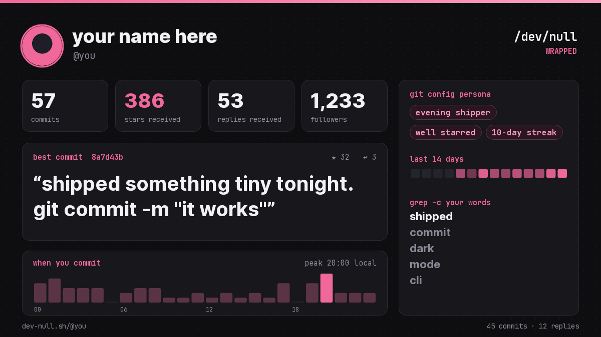

# /dev/null wrapped

**Your [/dev/null](https://dev-null.sh) in one card.** Type a username, get a PNG you can post.

### [▶ Make yours](https://renaissancexbt.github.io/devnull-wrapped/)



## What's on the card

- **commits, stars received, replies received, followers**
- **best commit**: your most starred commit, quoted
- **when you commit**: a 24-hour histogram in your local time, with your peak hour
- **git config persona**: night owl / early bird / day shift / evening shipper, reply guy or broadcaster, crowd favorite, screenshot enjoyer, your streak
- **last 14 days** and **grep -c your words**: what you post about most

Download it as a PNG, copy it straight to the clipboard, or share a link that rebuilds the card:
`https://renaissancexbt.github.io/devnull-wrapped/?u=nunomaduro`

## How it works

One static HTML file. It reads the public `dev-null.sh/api/v1` endpoints
(`users/{username}` and `users/{username}/commits`, following the cursor up to 800 commits),
computes everything in your browser and draws the card on a canvas. No server, no tracking,
nothing stored.

## Run it locally

```bash
git clone https://github.com/Renaissancexbt/devnull-wrapped && cd devnull-wrapped
python3 -m http.server 8000   # open http://localhost:8000/?u=your_username
```

Not affiliated with /dev/null. Made for fun by a user. MIT.

## Share cards (link previews)

Every share link points at `/u/<username>`, a tiny edge page whose `og:image` is that user's card,
rendered on the fly by `/api/og?u=<username>` (satori via `@vercel/og`). Paste the link into a
/dev/null commit, a tweet, Telegram or Discord and the card shows up under the post by itself,
no download or upload.

```
api/og.js    1200x630 PNG card for any /dev/null user (cached for an hour)
api/u.js     share page: OG/Twitter tags for the bots, instant redirect to the app for people
lib/card.js  fetch + stats + card layout, shared by both
```

Deploy: import the repo on Vercel, no settings needed.
